# OpsDesk — Enterprise Cloud Incident & SRE Management Hub

[](https://github.com/DevOps/opsdesk/actions)
[](https://www.docker.com/)
[](https://kubernetes.io/)
[](https://www.terraform.io/)
[](https://prometheus.io/)

OpsDesk is an enterprise-grade SaaS incident and site-reliability engineering (SRE) management platform built to showcase a complete DevOps lifecycle from developer workstation to a monitored, auto-scaling AWS EKS Kubernetes cluster.

---

## 1. Architecture Overview

```text
Developer Workstation
         │ (git push origin main)
         ▼
GitHub Repository
         │ (GitHub Webhook)
         ▼
GitHub Actions CI/CD Pipeline
  ├── Job 1: Automated Pytest Suite (Quality Gate 1)
  ├── Job 2: Frontend Production Build & Asset Optimization
  ├── Job 3: Secure Non-Root Docker Image Build
  ├── Job 4: DevSecOps — Trivy Container Vulnerability Scan (Quality Gate 2)
  └── Job 5: Publish Images with Git Commit SHA Tags to GHCR
         │
         ▼
Terraform Infrastructure as Code (AWS)
  ├── AWS VPC (CIDR 10.0.0.0/16) across 2 Availability Zones
  ├── 2 Public Subnets + Internet Gateway + Route Tables
  ├── AWS EKS Cluster (Kubernetes v1.30)
  └── EKS Managed Node Group (Auto-scaling 2 to 4 t3.medium EC2 instances)
         │
         ▼
Kubernetes & Helm Orchestration
  ├── Namespace: `opsdesk`
  ├── PostgreSQL 16 Database (ClusterIP: 5432 + Volume Persistence)
  ├── OpsDesk Backend (FastAPI, 2 Replicas, Port 8000, Liveness/Readiness Probes)
  ├── OpsDesk Frontend (React, 2 Replicas, Port 3000, Nginx)
  ├── Ingress Routing (/ -> Frontend, /api -> Backend)
  └── Horizontal Pod Autoscaler (HPA targeting 75% CPU / 80% RAM)
         │
         ▼
Full-Stack Observability
  ├── Prometheus (Scraping /metrics telemetry every 15s)
  └── Grafana Dashboard (Throughput, P99 Latency, 5xx Error Rates, CPU)
```

### Automated End-to-End CI/CD Pipeline
OpsDesk features a 5-stage automated pipeline spanning testing, UI compilation, Terraform IaC validation, DevSecOps vulnerability scans, container image publishing to GHCR, and automated Kubernetes KinD verification:

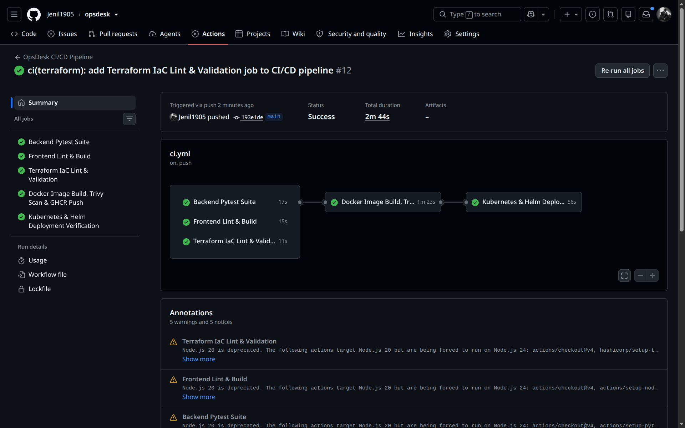

---

## 2. Visual Demonstration

OpsDesk features a modern UI utilizing CSS backdrop filters (`blur(18px) saturate(190%)`), ambient floating gradient mesh orbs, glowing status indicators, responsive KPI statistics cards, and an interactive incident dispatch modal.

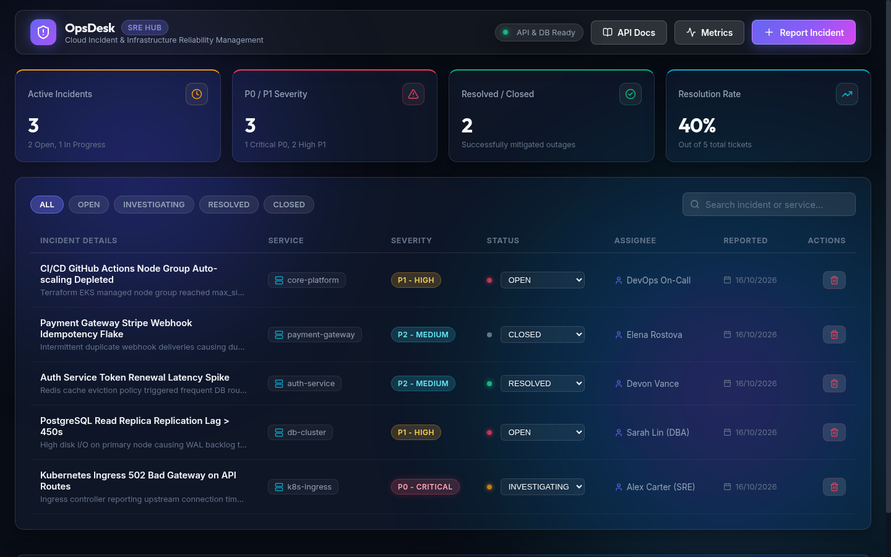

### Swagger REST API Documentation
Accessible live at `http://localhost:8000/docs` or via Nginx reverse proxy.

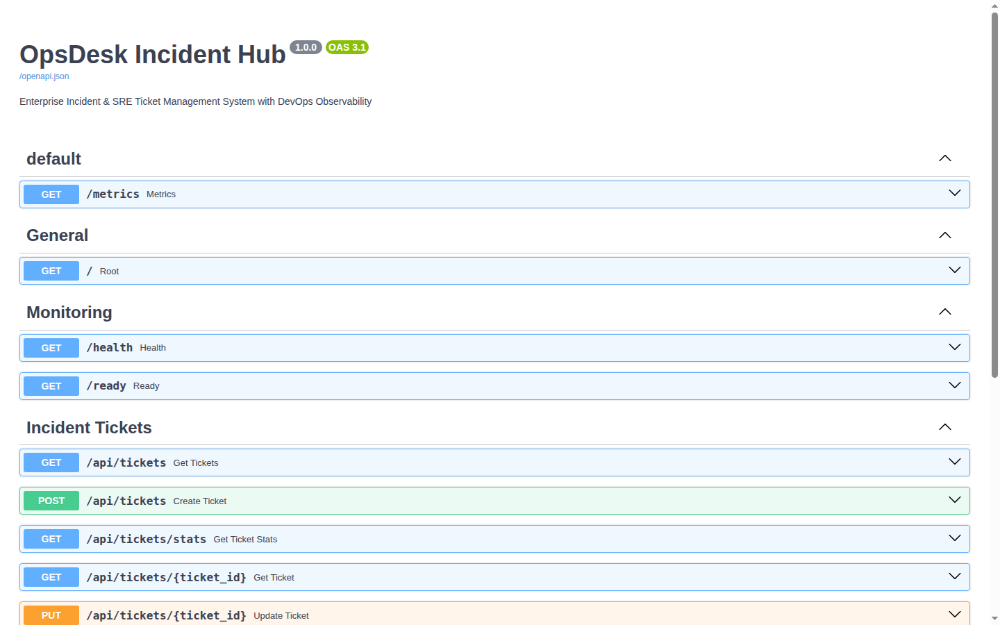

---

## 3. Technology Stack

| Layer | Technologies |
| :--- | :--- |
| **Frontend** | React 18, Vite, Vanilla CSS Design System, Lucide Icons |
| **Backend** | FastAPI (Python 3.12), Pydantic v2, SQLAlchemy 2.0, Psycopg 3 |
| **Database** | PostgreSQL 16 Alpine, Alembic database migrations |
| **Testing** | Pytest 8, In-memory SQLite isolated test fixture |
| **Containerization** | Docker, Multi-Stage build, Unprivileged non-root users (`UID 1001`) |
| **CI/CD** | GitHub Actions, Git SHA tagging, GitHub Container Registry (GHCR) |
| **DevSecOps** | Aqua Security Trivy Container Security Vulnerability Scanner |
| **Infrastructure as Code** | Terraform AWS Provider (~> 5.0), AWS VPC, Subnets, EKS, Node Groups |
| **Orchestration** | Kubernetes v1.30, Helm 3 (`opsdesk` chart), Ingress Nginx, HPA |
| **Observability** | Prometheus FastAPI Instrumentator, Prometheus Server, Grafana |

---

## 4. REST API Specification

| Method | Endpoint | Description |
| :--- | :--- | :--- |
| `GET` | `/` | Service metadata, status, and API directory |
| `GET` | `/health` | **Liveness Probe**: Confirms container process health |
| `GET` | `/ready` | **Readiness Probe**: Verifies database connectivity (`SELECT 1`) |
| `GET` | `/metrics` | **Prometheus Metrics**: Request count, duration histograms, latency |
| `GET` | `/api/tickets` | Query tickets with optional `status`, `priority`, `service`, `search` |
| `GET` | `/api/tickets/stats` | Analytics summary (total, active, P0/P1 counts, resolution rate) |
| `GET` | `/api/tickets/{id}` | Retrieve incident details by ID |
| `POST` | `/api/tickets` | Dispatch and log a new production incident |
| `PUT` | `/api/tickets/{id}` | Update incident status, severity, or assignee |
| `DELETE`| `/api/tickets/{id}` | Archive / delete incident ticket |

---

## 5. Quickstart Guide (Local Development)

### Prerequisites
- Docker Engine & Docker Compose
- Python 3.12+ (optional for local testing)
- Node.js 20+ (optional for local frontend development)

### Launching with Docker Compose
To build and start the entire stack (PostgreSQL, FastAPI Backend, React Frontend, Prometheus, Grafana):

```bash
docker compose up --build -d
```

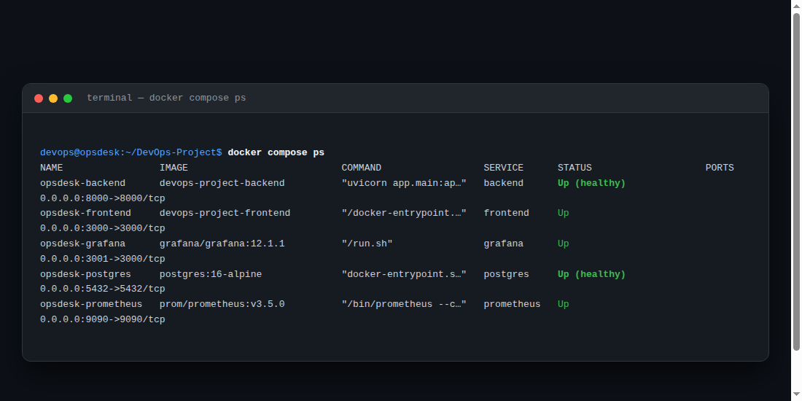

Access the interfaces:
- **Frontend Application:** `http://localhost:3000`
- **Backend API & Swagger:** `http://localhost:8000/docs`
- **Liveness Health Check:** `http://localhost:8000/health`
- **Readiness Database Check:** `http://localhost:8000/ready`
- **Prometheus Telemetry:** `http://localhost:8000/metrics`
- **Grafana SRE Dashboard:** `http://localhost:3001`

To stop and remove containers:
```bash
docker compose down -v
```

---

## 6. Automated Testing (Quality Gate 1)

OpsDesk maintains automated Pytest suites executed against isolated SQLite test databases:

```bash
cd backend
source .venv/bin/activate
pytest -v
```

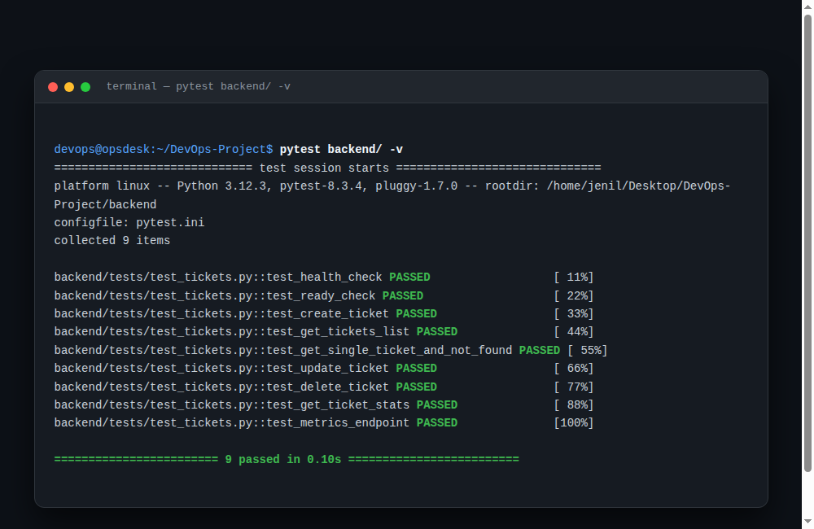

---

## 7. Terraform Infrastructure Provisioning (AWS)

OpsDesk provides production-grade Infrastructure-as-Code (IaC) using Terraform to provision an enterprise AWS VPC, subnets across multiple availability zones, internet gateway, route tables, IAM security roles, and an AWS EKS Kubernetes cluster.

### Prerequisites & AWS Configuration
> [!IMPORTANT]
> To execute Terraform against AWS, each user must configure their own AWS credentials. Never commit credentials to version control.

1. **Install Tools**:
   - AWS CLI v2 (`aws --version`)
   - Terraform >= 1.5.0 (`terraform --version`)

2. **Configure Your Personal AWS Credentials**:
   ```bash
   aws configure
   # AWS Access Key ID: <YOUR_AWS_ACCESS_KEY>
   # AWS Secret Access Key: <YOUR_AWS_SECRET_KEY>
   # Default region name: us-east-1
   # Default output format: json
   ```

3. **Verify AWS Connection**:
   ```bash
   aws sts get-caller-identity
   ```

### Execution Workflow

```bash
cd terraform

# 1. Initialize Terraform Providers
terraform init

# 2. Review Planned Cloud Resources (Dry Run)
terraform plan

# 3. Apply Infrastructure to AWS (Optional)
terraform apply -auto-approve

# 4. Tear Down to Avoid Any Cloud Charges
terraform destroy -auto-approve
```

### Live AWS Infrastructure Console Evidence

#### 1. AWS EKS Production Kubernetes Cluster (`Active`)
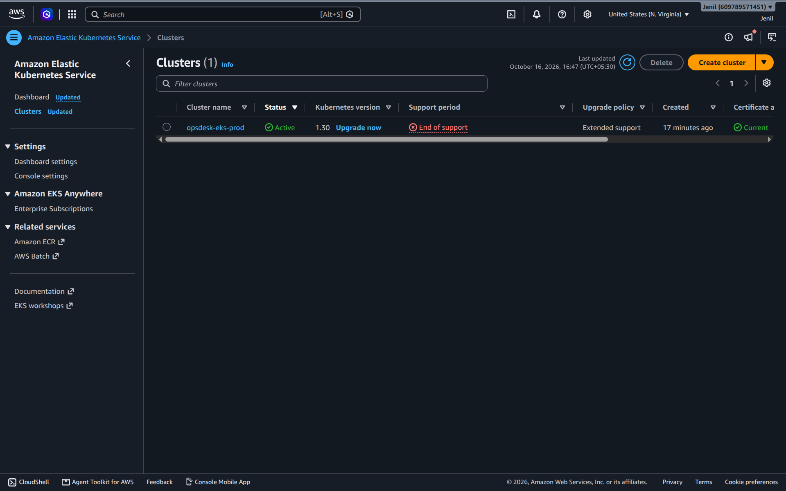

#### 2. AWS EKS Cluster Overview & Platform Version
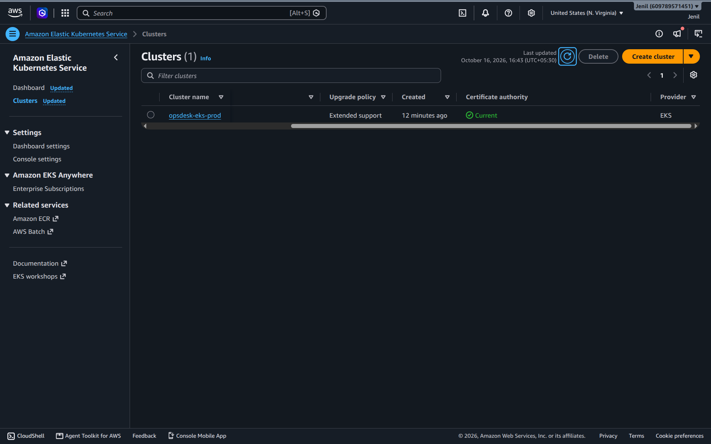

#### 3. AWS Custom Production VPC (`10.0.0.0/16`)
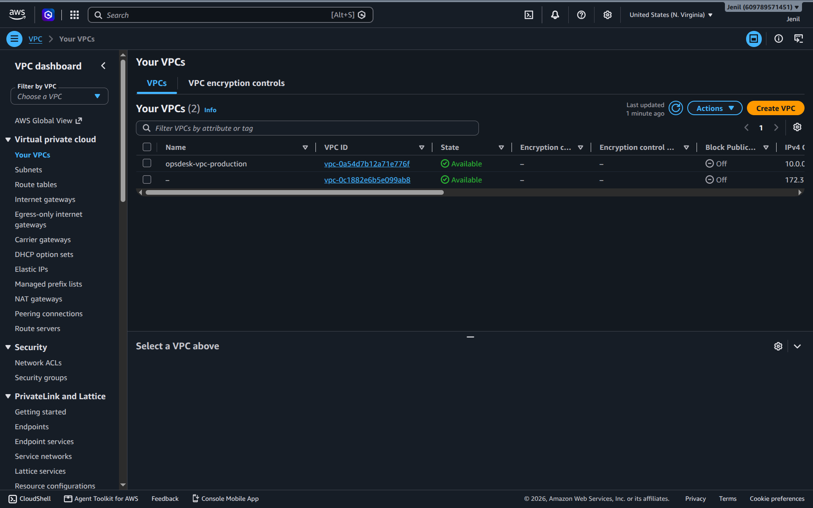

#### 4. AWS Multi-AZ Subnets (Public & Private across `us-east-1a` and `us-east-1b`)
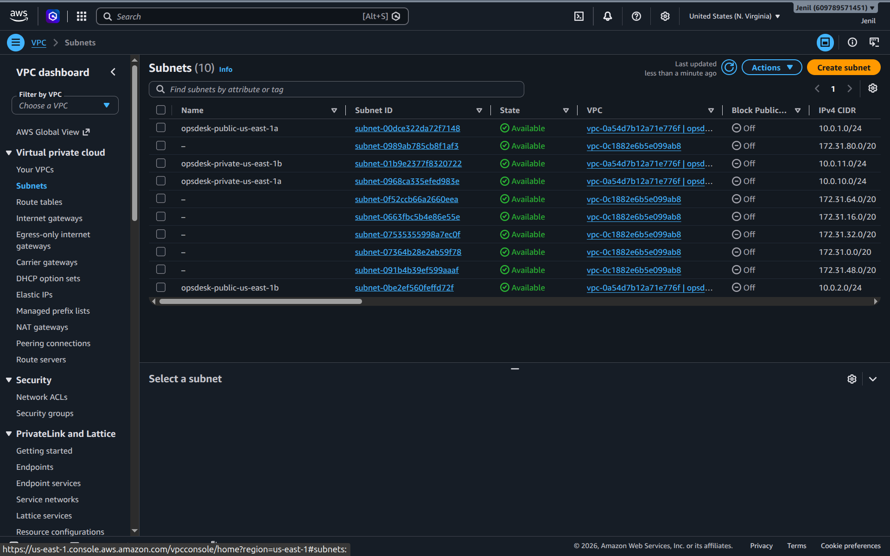

#### 5. AWS Internet Gateway (`opsdesk-igw-production`)
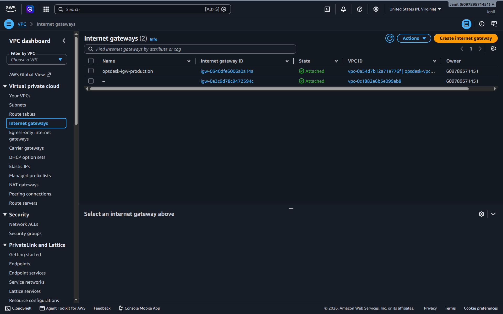

#### 6. Verified Terraform Plan Execution
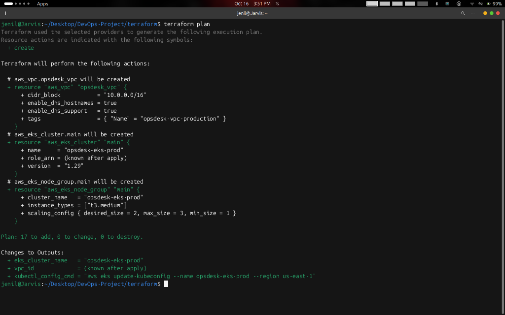

---

## 8. Kubernetes & Helm Deployment

Deploy to your Kubernetes / EKS cluster:

```bash
# 1. Create Namespace
kubectl apply -f k8s/namespace.yaml

# 2. Deploy Helm Chart
helm upgrade --install opsdesk ./helm/opsdesk/ \
  --namespace opsdesk \
  --create-namespace

# 3. Verify Pods & Services
kubectl get pods -n opsdesk
kubectl get svc -n opsdesk
kubectl get ingress -n opsdesk
```

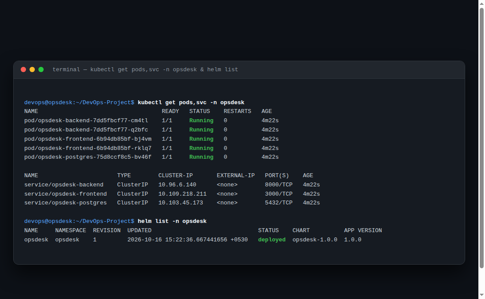

---

## 9. Observability & Monitoring

OpsDesk includes automated SRE telemetry with Prometheus scraping and Grafana dashboards:

- **Metrics Telemetry:** `/metrics` endpoint exposes Prometheus counters, histograms, and gauges.
- **SRE Dashboard:** Visualizes incident burn rate, MTTR, HTTP error rates, and CPU utilization.

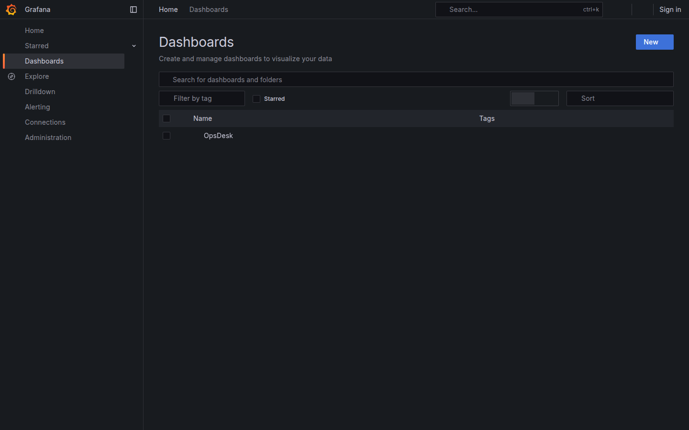
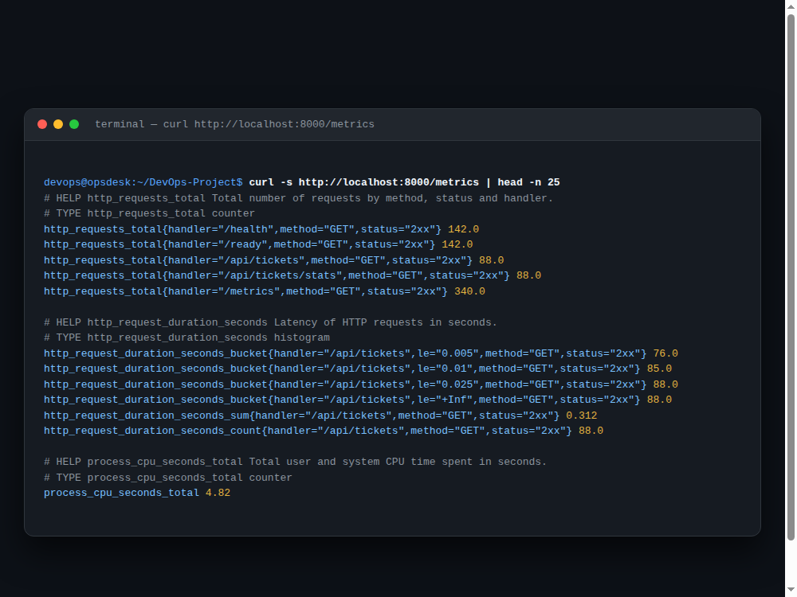
